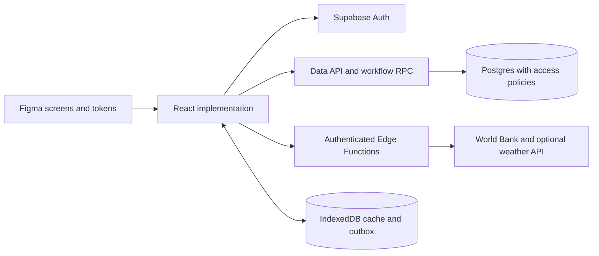

# Backend and Figma-first implementation

Updated 15 October 2026. This decision supersedes the earlier recommendation to defer shared persistence. The initial design update specified the backend and created the Figma prototype. The subsequent integration implements React, a local persistent Postgres API, and the Supabase adapter; see [current setup](local-and-supabase-setup.md).

## Complete stack

| Responsibility | Selection |
| --- | --- |
| Frontend design | Figma Design, editable layers and component instances, managed through Figma MCP |
| Application | React + TypeScript + Vite |
| Visual system | Figma variables mapped to CSS variables; DM Sans for headings/body; IBM Plex Mono for metadata |
| Frontend data access | Typed service functions using supabase-js; Zod at forms and external API boundaries |
| Shared database | Supabase Postgres, SQL migrations and synthetic seed data in Git |
| Identity and access | Supabase Auth, organization memberships, role-aware row-level security |
| Workflow transactions | Postgres functions called through RPC |
| External services | TypeScript Supabase Edge Functions for public API adapters and future provider integrations |
| Offline operation | IndexedDB via Dexie for cache and a pending-mutation outbox; service worker for application shell |
| Charts | Chart.js, using aggregates derived from stored records |
| Checks and delivery | Vitest, Playwright, GitHub Actions, static frontend hosting and a separate Supabase backend |

Supabase is the backend here. A separate Express or FastAPI application would add another deployment and duplicate services at this scope. It remains possible to introduce one later if requirements justify it.

Supabase documents [database functions](https://supabase.com/docs/guides/database/functions), [Edge Functions](https://supabase.com/docs/guides/functions), and [function authentication](https://supabase.com/docs/guides/functions/auth). Database functions suit transactional data changes; Edge Functions suit third-party calls and server-side integration logic.

## Request flow

Figma supplies design specifications and interaction references. The deployed application runs React code and calls the backend; it does not load its interface from Figma at runtime. There is no automatic bidirectional synchronization between the repository and the design file.

## Backend responsibilities

- Persist referrals and an append-only event history shared across CHW, supervisor, and facility views.
- Authenticate staff and authorize each operation by organization, assignment, and role.
- Validate allowed state transitions and event timestamps on the server.
- Create an in-app closure notification in the same transaction as the outcome event.
- Calculate consistent cohort reports through SQL views or read functions, respecting access policies.
- Deduplicate retried writes using a client-generated idempotency key.
- Fetch and cache public contextual data with source, observation time, retrieval time, and stale status.

Initial tables: organizations, memberships, facilities, referrals, referral_events, follow_up_tasks, notifications, expenses, and public_context_cache. Use a separate clinical outcome field rather than treating an adverse outcome as an open/closed status.

Role boundaries:

| Role | Planned access |
| --- | --- |
| CHW | Create and read assigned referrals, submit permitted updates, read and acknowledge own notifications |
| Supervisor | Read organization referrals, assign workers/tasks, log coordination actions |
| Facility staff | Read referrals addressed to their facility and record authorized receiving events |
| Program viewer | Organization-scoped aggregate reporting without unrestricted patient detail |

Store role membership server-side. A frontend role selector is only for the synthetic presentation. Database grants, policies, and functions must prevent direct writes from bypassing transition rules. Do not expose a privileged service key in the browser. A hosted public demo should use isolated/resettable synthetic sessions rather than granting anonymous users broad access to shared records.

## Proposed application service contract

These are planned operations, not endpoints that already exist. Reads can use the generated data API under access policies; workflow writes should use transactional RPC functions.

| Operation | Expected behavior |
| --- | --- |
| listReferrals(filters) | Authorized records with explicit pagination and consistent filter counts |
| createReferral(input, requestId) | Create referral plus initial event once |
| assignFollowUp(input, requestId) | Assign owner and next action with an event |
| recordReferralEvent(input, expectedVersion, requestId) | Validate permissions and state, then append an event and update the referral projection atomically |
| recordOutcome(input, expectedVersion, requestId) | Record outcome and closure notification atomically; retries return the prior result |
| acknowledgeNotification(id) | Mark acknowledgment without altering the clinical outcome |
| getProgramSummary(cohort) | Return totals and defined denominators from shared records |
| getPublicContext(location) | Return external context with provenance and explicit unavailable/stale states |

For offline edits, generate a request ID once, store the pending command, and retry that same command when connected. The backend returns an applied event or a conflict. Keep conflicting records pending for review rather than silently overwriting facility data. Show “Saved on device”, “Pending sync”, “Synced”, and “Needs review” as distinct states. The first connected implementation can ship online first; full offline synchronization is a separate acceptance milestone.

## Figma deliverable and implementation order

[Open the Tafu design file](https://www.figma.com/design/9T8dgasyFx6L9KKVfNMncD?node-id=2-222).

The first pass contains a supervisor queue, referral detail, mobile CHW creation form, facility confirmation, and CHW closure notification. It preserves the concept's palette and uses the requested DM Sans heading/body typography, uses fictional facilities and synthetic data, reuses Simple Design System button and field instances with Tafu styling, and includes a reusable referral row.

Navigation links demonstrate the handoff journey. Form entry, filtering, action submission, notification acknowledgment, live data, and offline sync are not implemented by these Figma screens. The facility screen illustrates eventual outcome recording; the backend must separately enforce arrival/contact/outcome sequencing. The program reporting view and a full set of loading/error/empty states remain future design work.

Implementation steps:

1. Refine the visual prototype and intended states in Figma.
2. Read the chosen Figma nodes through MCP design context and screenshots. Adapt the reference to the repository's React structure.
3. Implement shared CSS tokens, typography, Button, Field, ReferralRow, Timeline, and StatusNotice components. Use live semantic HTML for text/forms rather than exporting whole-screen images.
4. Build the database schema, synthetic seeds, grants/policies, transactional RPC functions, and typed frontend adapters.
5. Connect the screens to real backend operations and recompute queue/report totals from stored events.
6. Add public context adapters, then offline cache/outbox behavior as a distinct milestone.
7. Test authorized and unauthorized operations, duplicate submissions, stale-version conflicts, a complete referral journey, and small-screen layouts; commit and push each coherent update.

The repository records Figma file/node IDs and design-generation source for traceability. Those files are not a Figma file export or an implemented React frontend. Code Connect mapping can be added after the React components exist; it is not needed to begin the handoff.

## Initial design acceptance (historical)

Completed in this update: editable Figma screen creation, eight navigation reactions, visual review with clipping/wrapping fixes, font-family checks, and design/backend documentation. Inspection found text/frame/instance nodes and no whole-screen raster fills across all five screens.

Pending: React implementation, Supabase project provisioning, schema and policy implementation, provider integration, running application tests, and deployment. No backend credentials or paid infrastructure were created.

## Working integration update

A runnable local frontend/API now uses the shared SQL migration and access policies, with a Supabase client adapter ready for a provisioned project. The user-edited Figma hierarchy is preserved. Hosted credentials are not configured. Offline cache/outbox and the broader proposed analytics remain deferred. See [setup and verification boundaries](local-and-supabase-setup.md).
